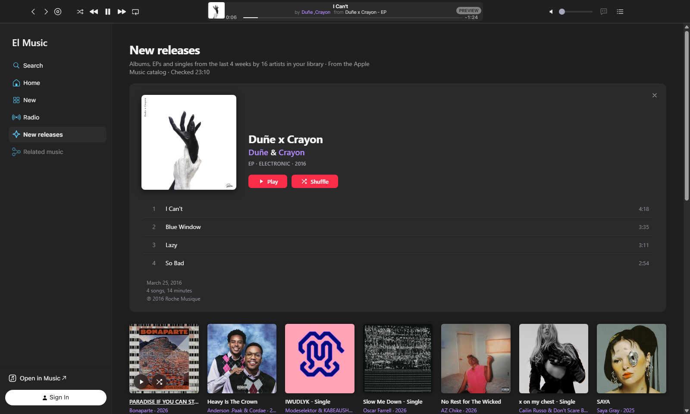
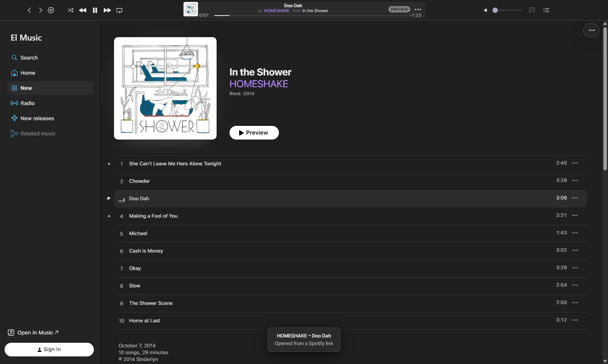
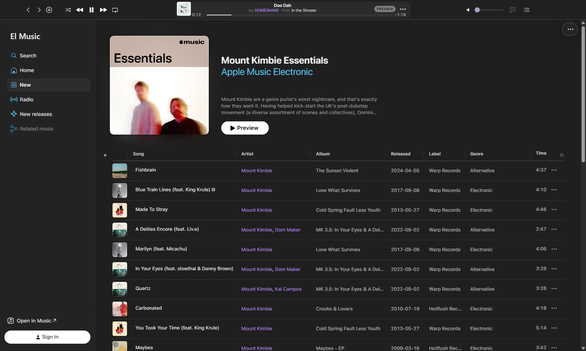

# El Music

A desktop app for Apple Music on Windows, built around Apple's own web player, with a few extras on top.

With the app El Music you listen to Apple Music in a window of its own: your library, your playlists and the whole catalog, with a compact player bar, record labels and release dates in your song lists, music related to what is playing, new releases from the artists you follow, and shared links that open with a paste.

*[Leer en castellano](README_ES.md)*

> El Music is an independent project. It is not affiliated with, endorsed or sponsored by Apple Inc. You need your own Apple Music subscription.

**[Download El Music for Windows](https://github.com/legandrop/LGA_ElMusic/releases/latest)**

## What you get

- **A compact player bar.** Song on top, "by Artist from Album" below, with Back and Forward buttons, volume, lyrics and the queue. Click the artist or the album to open it; click the song to go back to the list you played it from.
- **Paste a link to open it.** Copy a link someone shared with you and press **Ctrl+V** anywhere in the app. Apple Music links open the album, song, artist or playlist right away. Spotify links to a song, album or artist open the same music on Apple Music; if there is no exact match, you get Apple Music search results instead.

  
- **Related music.** A list of songs that go with the one that is playing. Press Play on any of them and the app plays the whole list, starting there. An optional free Last.fm key makes the suggestions better.
- **New releases.** Albums released in the last four weeks by the artists in your library, in one list. Point at a cover and press **Play** or **Shuffle**: that album plays, then the next one in the list, and so on to the end. Shuffle mixes the songs of each album but keeps the albums in order. Click a cover to open that album right there, at the top of the list, with its songs; click another and it takes its place. While an album from the list is playing, the open one follows the music.
- **Record labels in your song lists.** Playlists and albums get Label, Released and Genre columns. Click a label to see its releases, with the same Play and Shuffle on each cover.

  
- **Song lists your way.** Sort by song, artist, album or label; drag columns to reorder them, resize them, or hide the ones you don't need. Long playlists load completely, with the song count and total time at the bottom.
- **Back takes you back.** Wherever you go from New releases or a label (an artist, say), Back returns you to that list right away, scrolled to where you were.
- **Shuffle is remembered** between sessions.
- **Stream Deck keys** (optional): previous, play/pause, next, open/minimize the app, and "add the song that is playing to a playlist", one key per playlist.
- **You always know it is working.** A thin red line runs under the player bar while a page loads, and a spinner shows while a song you asked for starts.

## What you need

- Windows 10 or 11, 64-bit. (A Mac version is on its way.)
- An Apple Music subscription and your Apple Account.
- An internet connection.

## Install

1. Download `LGA_ElMusic_Setup_v<version>.exe` from the [Releases](https://github.com/legandrop/LGA_ElMusic/releases/latest) page.
2. Open it. Windows may say **"Windows protected your PC"**. That happens because El Music is not signed with a paid code-signing certificate. Click **More info**, then **Run anyway**. You only have to do this once.
3. Follow the installer. It needs no administrator rights: it installs El Music for your user in `C:\Portable\LGA\ElMusic` (you can pick another folder) and adds it to the Start menu. A desktop shortcut is optional. At the end, leave **Launch El Music** checked.
4. Sign in with your Apple Account. The sign-in page is Apple's own; El Music never sees your password.
5. The first time, El Music shows "Preparing your music" while it downloads Google's Widevine module, which Apple Music needs to play protected music. This happens once and can take a minute.

If a firewall asks whether El Music may connect, allow it. El Music tries again three times, five seconds apart, before showing an error; if the error shows anyway, choose **El Music › Retry loading**.

Some firewalls ask again the first time you play a song, because playback uses other Apple servers. If Apple Music shows "An error occurred" and El Music says "Your firewall blocked El Music", allow it, choose **El Music › Retry loading** and play the song again.

## Updates

El Music updates itself. It looks for a new version when it starts and every few hours, and when there is one it tells you what's new and lets you choose: **Update Now**, **Remind Me Later**, **Skip This Version** or **Cancel**.

With **Update Now**, El Music downloads the installer while you keep listening (a notice at the bottom right shows the progress), checks that the file is exactly the one published here, and closes. The installer opens on the same folder; at the end El Music opens again, with your sign-in and settings as they were.

- **El Music › Check for Updates…** looks right away. **Check for Updates Automatically**, in the same menu, turns the automatic check on or off.
- **Help › What's New** lists the changes of each version.
- If an update ever fails, download the latest installer from the [Releases](https://github.com/legandrop/LGA_ElMusic/releases/latest) page and run it: it installs over the same folder.

## Optional extras

**Better Related music with Last.fm.** Open **El Music › Settings…**, click **Get a free API key**, create a key on the Last.fm site and paste it back in Settings. The key stays on your computer. Without a key, El Music never contacts Last.fm.

**Stream Deck.** With the Stream Deck app installed, choose **El Music › Install Stream Deck plugin…** and accept in Stream Deck. Each "Add to Playlist" key has its own playlist, chosen in the key settings. El Music has to be open for the keys to work; once you have opened El Music at least once, the Open / Minimize key can also start it.

**Artist color.** Artist names are purple; you can pick another color in Settings.

## Privacy

- Music, sign-in and your library stay with Apple: El Music shows Apple's own web player.
- No analytics, no tracking and no accounts other than your Apple Account.
- To add its extras, El Music asks public music databases for information about the music on screen: the Apple Music catalog, the iTunes Search API, MusicBrainz and ListenBrainz. It contacts Last.fm only if you add your own key, and Spotify only when you paste a Spotify link, to read that one public page.
- To look for updates, El Music reads the list of versions published at legandrop.github.io and downloads installers only from this repository's releases, checking each one against its published SHA-256.
- A diagnostic log stays on your computer (**Help › Show diagnostic log**). It records errors and timings, never your account, passwords or what you listen to.

## Good to know

- El Music depends on Apple's website. When Apple changes it, a feature may stop working until a new version of El Music is out.
- It plays what the Apple Music web player plays. There are no offline downloads.
- Spotify matching goes by title, artist and length, so now and then it may open a different edition of the same song.

## Uninstall

Open Windows **Settings › Apps › Installed apps**, find **El Music** and choose **Uninstall**. It removes the app, its `data` folder (your sign-in and caches) and its settings in `%APPDATA%\LGA\ElMusic`.

## Building from source

El Music is TypeScript on [Castlabs Electron for Content Security](https://github.com/castlabs/electron-releases), a version of Electron that can play protected music.

1. Run `tools\setup-node-win.ps1` (or `tools/setup-node-mac.sh` on a Mac). It downloads the exact Node.js version into `tools/` and checks its hash. Nothing is installed system-wide.
2. Install the dependencies with the npm inside that folder, for example on Windows: `tools\node-v24.21.0-win-x64\npm.cmd ci`.
3. Build with `compilar.bat --no-run` (Windows) or `./compilar.sh --no-run` (Mac), and run the tests with that same npm: `npm test`.

To build the installer, sign the build first (see below) and run `node scripts/installer-win.mjs` with [Inno Setup 6](https://jrsoftware.org/isinfo.php) installed. The installer script is `LGA_ElMusic_installer.iss`.

A build made this way opens Apple Music but cannot play it: Apple Music only plays in apps signed for production through Castlabs' EVS service. EVS is free, but you need your own Castlabs account. The signing steps are in `scripts/sign-win.mjs` and `scripts/sign-mac.mjs`.

## Contributing

El Music is a personal project. It does not take contributions, issues or feature requests.

## License

MIT, see [LICENSE](LICENSE). Third-party components and data sources are listed in [THIRD_PARTY_NOTICES.md](THIRD_PARTY_NOTICES.md).

Apple, Apple Music and iTunes are trademarks of Apple Inc. Spotify is a trademark of Spotify AB. Stream Deck is a trademark of Corsair Memory, Inc. Last.fm, MusicBrainz and ListenBrainz belong to their respective owners.
