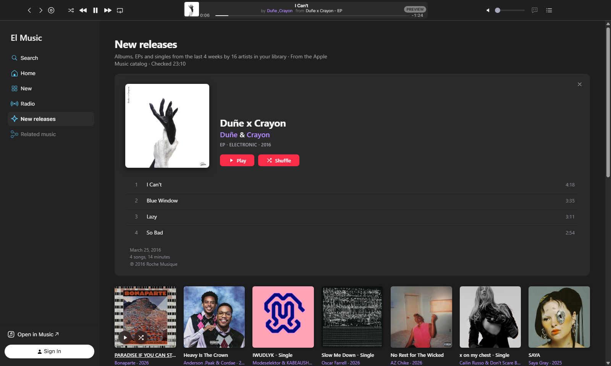
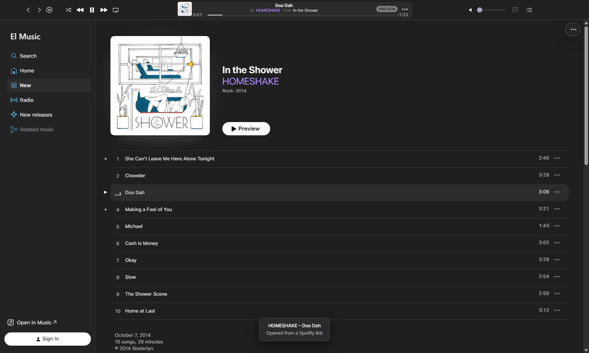
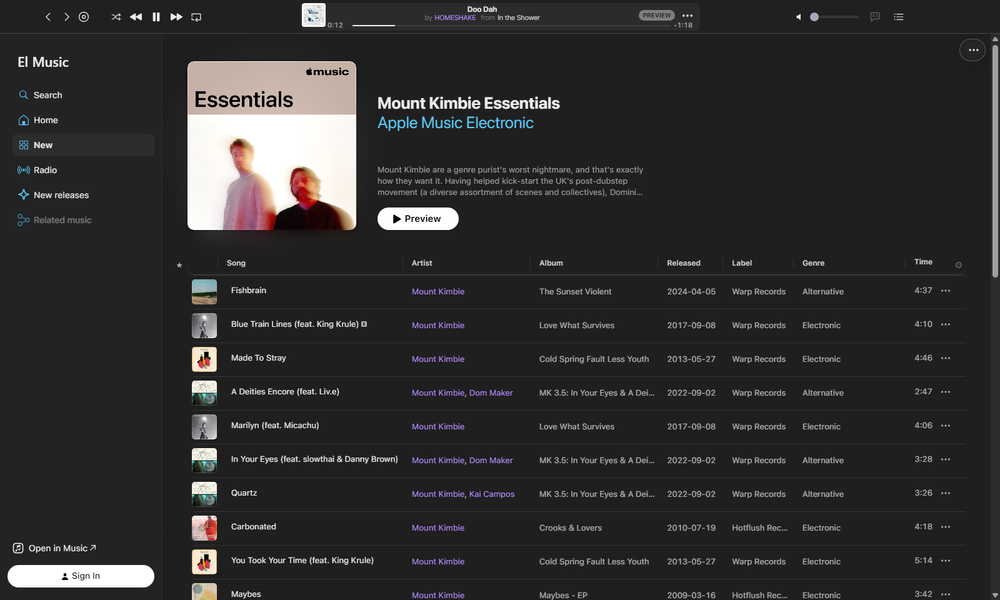

# El Music

Una app de escritorio para Apple Music en Windows, armada alrededor del reproductor web oficial de Apple, con algunos agregados.

La app El Music te deja escuchar Apple Music en una ventana propia: tu biblioteca, tus playlists y todo el catálogo, con una barra de reproducción compacta, sellos discográficos y fechas de lanzamiento en las listas de canciones, música relacionada con lo que está sonando, novedades de los artistas que seguís y links compartidos que se abren con sólo pegarlos.

*[Read in English](README.md)*

> El Music es un proyecto independiente. No está afiliado a Apple Inc., ni cuenta con su respaldo o patrocinio. Hace falta tu propia suscripción a Apple Music.

**[Bajar El Music para Windows](https://github.com/legandrop/LGA_ElMusic/releases/latest)**

## Qué trae

- **Una barra de reproducción compacta.** La canción arriba y «by Artista from Álbum» abajo, con botones Atrás y Adelante, volumen, letras y la cola. Un clic en el artista o el álbum lo abre; un clic en la canción te devuelve a la lista desde donde la pusiste.
- **Pegá un link y se abre.** Copiá un link que te pasaron y apretá **Ctrl+V** en cualquier parte de la app. Los links de Apple Music abren el disco, tema, artista o playlist al instante. Los de Spotify (tema, disco o artista) abren la misma música en Apple Music; si no hay una coincidencia exacta, muestran los resultados de búsqueda de Apple Music.

  
- **Música relacionada.** Una lista de temas que van con el que está sonando. Con Play en cualquiera, la app reproduce toda la lista empezando por ese. Una clave gratuita de Last.fm, opcional, mejora las sugerencias.
- **Novedades.** Los discos que sacaron en las últimas cuatro semanas los artistas de tu biblioteca, en una sola lista. Pasá el mouse por una tapa y apretá **Play** o **Shuffle**: suena ese disco, después el siguiente de la lista, y así hasta el final. Shuffle mezcla los temas de cada disco pero respeta el orden de los discos. Un clic en una tapa abre ese disco ahí mismo, arriba de la lista, con sus temas; un clic en otra lo reemplaza. Mientras suena un disco de la lista, el que está abierto sigue a la música.
- **Sellos en tus listas de canciones.** Las playlists y los discos suman las columnas Label, Released y Genre. Un clic en un sello muestra sus lanzamientos, con el mismo Play y Shuffle sobre cada tapa.

  
- **Listas a tu manera.** Ordená por canción, artista, álbum o sello; arrastrá las columnas para cambiarles el orden, cambiales el ancho u ocultá las que no uses. Las playlists largas se cargan enteras, con la cantidad de temas y la duración total al pie.
- **Atrás te devuelve a donde estabas.** Vayas a donde vayas desde Novedades o desde un sello (un artista, por ejemplo), Atrás te devuelve a esa lista al instante, a la misma altura.
- **El modo aleatorio se recuerda** de una sesión a otra.
- **Teclas para Stream Deck** (opcional): anterior, play/pausa, siguiente, abrir/minimizar la app y «agregar el tema que suena a una playlist», una tecla por playlist.
- **Siempre sabés que está trabajando.** Una línea roja fina corre bajo la barra mientras carga una página, y un anillo gira mientras arranca el tema que pediste.

## Qué hace falta

- Windows 10 u 11 de 64 bits. (La versión para Mac está en camino.)
- Una suscripción a Apple Music y tu cuenta de Apple.
- Conexión a internet.

## Instalación

1. Bajá `LGA_ElMusic_Setup_v<versión>.exe` de la página de [Releases](https://github.com/legandrop/LGA_ElMusic/releases/latest).
2. Abrilo. Windows puede decir **«Windows protegió su PC»**. Pasa porque El Music no está firmada con un certificado de firma de código pago. Hacé clic en **Más información** y después en **Ejecutar de todas formas**. Se hace una sola vez.
3. Seguí el instalador. No pide permisos de administrador: instala El Music para tu usuario en `C:\Portable\LGA\ElMusic` (podés elegir otra carpeta) y la suma al menú Inicio. El acceso directo en el escritorio es opcional. Al final, dejá marcada la casilla para abrir El Music.
4. Iniciá sesión con tu cuenta de Apple. La página de inicio de sesión es la de Apple; El Music nunca ve tu contraseña.
5. La primera vez, El Music muestra «Preparing your music» mientras baja el módulo Widevine de Google, que Apple Music necesita para reproducir música protegida. Pasa una sola vez y puede tardar un minuto.

Si un firewall pregunta si El Music puede conectarse, permitilo. El Music reintenta tres veces, cada cinco segundos, antes de mostrar un error; si igual aparece, elegí **El Music › Retry loading**.

Algunos firewalls vuelven a preguntar la primera vez que reproducís un tema, porque la reproducción usa otros servidores de Apple. Si Apple Music muestra «Ocurrió un error» y El Music avisa «Your firewall blocked El Music», permitilo, elegí **El Music › Retry loading** y volvé a dar Play.

## Actualizaciones

El Music se actualiza sola. Busca una versión nueva al abrirse y cada algunas horas, y cuando hay una te cuenta qué trae y te deja elegir: **Update Now** (actualizar ahora), **Remind Me Later** (recordar mañana), **Skip This Version** (saltear esta versión) o **Cancel**.

Con **Update Now**, El Music baja el instalador mientras seguís escuchando (un aviso abajo a la derecha muestra el avance), comprueba que el archivo sea exactamente el publicado acá y se cierra. El instalador se abre sobre la misma carpeta y al terminar El Music vuelve a abrirse, con tu sesión y tus ajustes como estaban.

- **El Music › Check for Updates…** busca en el momento. **Check for Updates Automatically**, en el mismo menú, prende o apaga la búsqueda automática.
- **Help › What's New** muestra los cambios de cada versión.
- Si alguna vez una actualización falla, bajá el último instalador de la página de [Releases](https://github.com/legandrop/LGA_ElMusic/releases/latest) y abrilo: instala sobre la misma carpeta.

## Extras opcionales

**Mejor música relacionada con Last.fm.** Abrí **El Music › Settings…**, hacé clic en **Get a free API key**, creá una clave en el sitio de Last.fm y pegala en Settings. La clave queda en tu computadora. Sin clave, El Music nunca se conecta con Last.fm.

**Stream Deck.** Con la app de Stream Deck instalada, elegí **El Music › Install Stream Deck plugin…** y aceptá en Stream Deck. Cada tecla «Add to Playlist» tiene su propia playlist, que se elige en los ajustes de la tecla. El Music tiene que estar abierta para que las teclas funcionen; una vez que la abriste al menos una vez, la tecla Open / Minimize también puede abrirla.

**Color de los artistas.** Los nombres de artista son violetas; en Settings podés elegir otro color.

## Privacidad

- La música, el inicio de sesión y tu biblioteca quedan en Apple: El Music muestra el reproductor web de Apple.
- Sin estadísticas de uso, sin rastreo y sin otras cuentas que la de Apple.
- Para sus agregados, El Music consulta bases de datos musicales públicas sobre la música que está en pantalla: el catálogo de Apple Music, la búsqueda pública de iTunes, MusicBrainz y ListenBrainz. Se conecta con Last.fm sólo si cargás tu propia clave, y con Spotify sólo cuando pegás un link de Spotify, para leer esa única página pública.
- Para buscar actualizaciones, El Music lee la lista de versiones publicada en legandrop.github.io y baja instaladores sólo de los releases de este repositorio, comprobando cada uno contra su SHA-256 publicado.
- Un registro de diagnóstico queda en tu computadora (**Help › Show diagnostic log**). Anota errores y tiempos, nunca tu cuenta, contraseñas ni lo que escuchás.

## Para tener en cuenta

- El Music depende del sitio de Apple. Cuando Apple lo cambia, alguna función puede dejar de andar hasta que salga una versión nueva de El Music.
- Reproduce lo mismo que el reproductor web de Apple Music. No hay descargas para escuchar sin conexión.
- El paso de Spotify a Apple Music compara título, artista y duración, así que alguna vez puede abrir otra edición del mismo tema.

## Desinstalar

Abrí **Configuración › Aplicaciones › Aplicaciones instaladas** de Windows, buscá **El Music** y elegí **Desinstalar**. Borra la app, su carpeta `data` (tu sesión y los cachés) y sus ajustes en `%APPDATA%\LGA\ElMusic`.

## Compilar desde el código

El Music está hecha en TypeScript sobre [Castlabs Electron for Content Security](https://github.com/castlabs/electron-releases), una versión de Electron que puede reproducir música protegida.

1. Corré `tools\setup-node-win.ps1` (o `tools/setup-node-mac.sh` en una Mac). Baja la versión exacta de Node.js dentro de `tools/` y verifica su hash. No instala nada en el sistema.
2. Instalá las dependencias con el npm de esa carpeta, por ejemplo en Windows: `tools\node-v24.21.0-win-x64\npm.cmd ci`.
3. Compilá con `compilar.bat --no-run` (Windows) o `./compilar.sh --no-run` (Mac) y corré las pruebas con ese mismo npm: `npm test`.

Para armar el instalador, primero firmá la versión compilada (ver abajo) y corré `node scripts/installer-win.mjs` con [Inno Setup 6](https://jrsoftware.org/isinfo.php) instalado. El script del instalador es `LGA_ElMusic_installer.iss`.

Una versión compilada así abre Apple Music pero no puede reproducir: Apple Music sólo suena en apps firmadas para producción con el servicio EVS de Castlabs. EVS es gratis, pero hace falta una cuenta propia de Castlabs. Los pasos de la firma están en `scripts/sign-win.mjs` y `scripts/sign-mac.mjs`.

## Contribuciones

El Music es un proyecto personal. No recibe contribuciones, reportes ni pedidos de funciones.

## Licencia

MIT, ver [LICENSE](LICENSE). Los componentes y las fuentes de datos de terceros están en [THIRD_PARTY_NOTICES.md](THIRD_PARTY_NOTICES.md).

Apple, Apple Music e iTunes son marcas de Apple Inc. Spotify es una marca de Spotify AB. Stream Deck es una marca de Corsair Memory, Inc. Last.fm, MusicBrainz y ListenBrainz pertenecen a sus respectivos dueños.
